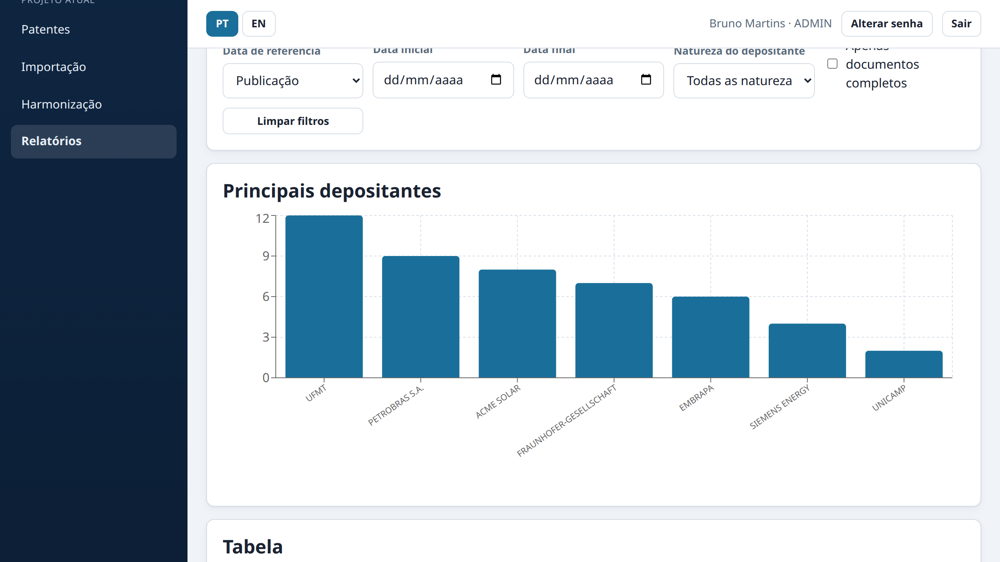

# Periscope

Plataforma web da **Universidade Federal de Mato Grosso (UFMT)** para prospecção tecnológica, análise e harmonização de patentes. Reúne exportações de múltiplas bases em projetos compartilhados, unifica grafias divergentes de depositantes e inventores com busca fuzzy em **Apache Lucene 9** e gera **13 indicadores interativos** prontos para análise e exportação em CSV.

**[Acessar apresentação e vídeo 1440p 60fps](https://brunomartinsmv.github.io/periscope/)** · **[Documentação da API (OpenAPI)](#api-rest)** · **[Início rápido com Docker](#início-rápido-com-docker)**

[](https://brunomartinsmv.github.io/periscope/)

## Principais recursos

- **Importação multi-base e dossiê completo:** importe planilhas e arquivos do **Espacenet**, **Patentscope** e **DPMA** ou cadastre patentes manualmente, com edição completa de títulos, resumos, classificações IPC/CPC, múltiplas prioridades e anexos PDF armazenados em **MongoDB GridFS**.
- **Harmonização fuzzy com Apache Lucene 9 (Fast-Join):** localize variações gráficas de empresas, universidades e inventores por similaridade de tokens, agrupe sob um nome canônico com país, UF e natureza jurídica, aplique em lote e edite ou desfaça regras sem perder os dados originais.
- **13 relatórios interativos e exportação CSV:** rankings de depositantes e inventores, evolução temporal por depósito, publicação e prioridade, classificações IPC e CPC com descrição de seções, natureza jurídica, distribuição estadual/regional no Brasil e tabela de prioridade nacional — com filtros por período, natureza e completude.
- **Colaboração, segurança e internacionalização:** controle de acesso por projeto (proprietários, observadores e administradores), gestão de usuários, interface bilíngue (**Português / English**) servida em um único pacote e autenticação via JWT HS256 / cookie `HttpOnly` com revogação ativa.

## Início rápido com Docker

Pré-requisitos: **Docker** e **Docker Compose**.

```bash
git clone https://github.com/brunomartinsmv/periscope.git
cd periscope
docker compose up --build -d
# ou: ./scripts/dev-up.sh
```

O build multi-stage compila a interface React, empacota o WAR com Maven e sobe o **WildFly 34** junto ao **MongoDB 7** com health check automático.

| Serviço | URL | Descrição |
|---------|-----|-----------|
| **Aplicação web** | http://localhost:8080/periscope/app/ | Interface principal (`pt-BR` / `en-US`) |
| **Atalho raiz** | http://localhost:8080/periscope/ | Redireciona para `/periscope/app/` |
| **API REST** | http://localhost:8080/periscope/rest/ | Endpoints JAX-RS (cookie `HttpOnly` ou Bearer) |
| **OpenAPI 3** | http://localhost:8080/openapi | Especificação MicroProfile OpenAPI (SmallRye) |
| **Health check** | http://localhost:8080/periscope/rest/health | Estado do MongoDB e do índice Lucene |

Em ambiente local, a conta inicial padrão criada no primeiro deploy é `admin` com senha `123456`. Para encerrar os containers, execute `./scripts/dev-down.sh` ou `docker compose down`.

## Implantação em produção (HTTPS)

Para servidores institucionais ou nuvem, utilize [`docker-compose.prod.yml`](docker-compose.prod.yml) com as variáveis configuradas a partir de [`.env.example`](.env.example):

```bash
cp .env.example .env
$EDITOR .env
docker compose -f docker-compose.prod.yml up --build -d
```

A stack de produção inclui:

- **MongoDB 7 autenticado** isolado em rede interna (sem exposição direta de portas).
- **Proxy reverso Caddy 2** ([`deploy/Caddyfile`](deploy/Caddyfile)) com TLS automático e cabeçalhos de segurança.
- **Validação estrita na inicialização (`PERISCOPE_PRODUCTION=true`):** exige `PERISCOPE_JWT_SECRET` (mínimo de 32 bytes), `PERISCOPE_ADMIN_PASSWORD` forte (mínimo de 8 caracteres) e ativa cookies `Secure` + troca obrigatória de senha no primeiro acesso do administrador.

## Arquitetura e tecnologias

| Camada | Tecnologia |
|--------|------------|
| **Interface web** | React 19, Vite, TypeScript, Recharts (`periscope-ui`, i18n `pt-BR` / `en-US`) |
| **Backend e API** | Java 21, Jakarta EE 10 (JAX-RS, EJB), WildFly 34.0.1.Final, MicroProfile OpenAPI |
| **Harmonização** | Apache Lucene 9.12.0 (índice Fast-Join) |
| **Persistência** | MongoDB 7, Morphia 2.5.3, `mongodb-driver-sync` 5.2.1 e GridFS |
| **Documentos** | Apache POI 5.3.0 e Apache PDFBox 3.0.3 |
| **Empacotamento** | WAR único (`periscope-web/target/periscope.war`) com EJB e SPA embutidos |

```text
periscope/
├── periscope-ejb/   # Domínio, persistência Morphia, índice Lucene, importadores e 13 relatórios
├── periscope-web/   # API REST JAX-RS, autenticação/RBAC e empacotamento do WAR único
├── periscope-ui/    # Aplicação React + Vitest + testes E2E Playwright
└── docs/            # Página de apresentação (GitHub Pages) e documentação técnica
```

## Desenvolvimento local e build manual

Pré-requisitos: **JDK 21**, **Maven 3.9+**, **Node.js 22+**, **MongoDB 4.4+** (7.x recomendado) e **WildFly 34.0.1.Final**.

### Build completo e deploy no WildFly 34

```bash
export JAVA_HOME=/usr/lib/jvm/java-21-openjdk-amd64

# 1. Compilar a interface React e incorporar ao WAR
cd periscope-ui && npm ci && npm run build:war && cd ..

# 2. Compilar, rodar testes unitários e gerar periscope.war
mvn -B clean verify

# 3. Garantir diretório gravável para o índice Lucene
mkdir -p /opt/periscope

# 4. Habilitar OpenAPI (uma vez por instalação, com o servidor parado) e iniciar o WildFly
JBOSS_HOME=/opt/jboss/wildfly-34.0.1.Final ./tools/enable-wildfly-openapi.sh
cd /opt/jboss/wildfly-34.0.1.Final && ./bin/standalone.sh -b 0.0.0.0

# 5. Em outro terminal, publicar o WAR
cp periscope-web/target/periscope.war \
   /opt/jboss/wildfly-34.0.1.Final/standalone/deployments/
```

### Servidor de desenvolvimento do frontend

Com o backend rodando em `localhost:8080`, inicie o Vite com hot reload:

```bash
cd periscope-ui
npm ci
npm run dev
# Interface em http://localhost:5173/periscope/app/ (proxy automático para /periscope/rest)
```

## Variáveis de ambiente

| Variável | Padrão | Descrição |
|----------|--------|-----------|
| `MONGODB_URI` | `mongodb://localhost:27017` | URI de conexão com o MongoDB |
| `MONGODB_DATABASE` | `Periscope` | Nome da base de dados |
| `PERISCOPE_DIR` | `/opt/periscope` | Diretório gravável do índice Lucene |
| `PERISCOPE_PRODUCTION` | `false` | Em `true`, ativa validações obrigatórias de segredos e senha inicial |
| `PERISCOPE_COOKIE_SECURE` | `false` (`true` em HTTPS) | Define atributo `Secure` no cookie de sessão `HttpOnly` |
| `PERISCOPE_JWT_SECRET` | *(gerado em dev)* | Segredo HS256 com ≥ 32 bytes (obrigatório em produção) |
| `PERISCOPE_JWT_EXPIRATION_HOURS` | `8` | Tempo de validade do token de sessão |
| `PERISCOPE_CORS_ORIGINS` | `http://localhost:5173` | Origens permitidas no CORS (separadas por vírgula) |
| `PERISCOPE_ADMIN_USERNAME` | `admin` | Usuário administrador criado no primeiro deploy |
| `PERISCOPE_ADMIN_PASSWORD` | `123456` | Senha inicial do administrador (obrigatória e ≥ 8 caracteres em produção) |
| `PERISCOPE_ADMIN_EMAIL` | `admin@ufmt.br` | E-mail do administrador inicial |
| `PERISCOPE_FORCE_ADMIN_PASSWORD_CHANGE` | `false` (`true` em prod) | Obriga troca de senha no primeiro login do administrador |

## API REST

Base padrão: `http://localhost:8080/periscope/rest` (context root `/periscope` definido em `WEB-INF/jboss-web.xml`).

| Área | Endpoints principais |
|------|----------------------|
| **Autenticação** | `POST /auth/login`, `GET /auth/me`, `POST /auth/refresh`, `POST /auth/change-password`, `POST /auth/logout` |
| **Referência** | `GET /reference/countries`, `GET /reference/applicant-types`, `GET /reference/users` |
| **Projetos** | CRUD `/projects`, observadores `POST` / `DELETE /projects/{id}/observers/{userId}` |
| **Patentes** | `/projects/{id}/patents` (`GET`/`POST`), `/patents/{id}` (`GET`/`PUT`/`DELETE`), importação multipart |
| **Harmonização** | Sugestões Fast-Join, listagem de entidades (`/entities`), criação/edição/desfazer/aplicação de regras (`/rules`) |
| **Relatórios** | 13 indicadores com filtros, autocomplete (`/reports/applicants`, `/reports/inventors`) e `docs-national-priority` |
| **Usuários** | CRUD completo `/users` (restrito a `ADMIN`) |
| **Arquivos** | Upload e download de anexos PDF em GridFS (`/files`) com verificação de acesso por projeto |
| **Saúde** | `GET /health` |

Autenticação aceita cookie `HttpOnly` (`periscope_token`) ou cabeçalho `Authorization: Bearer <token>`:

```bash
TOKEN=$(curl -s -X POST http://localhost:8080/periscope/rest/auth/login \
  -H 'Content-Type: application/json' \
  -d '{"username":"admin","password":"123456"}' | jq -r .token)

curl -s http://localhost:8080/periscope/rest/auth/me -H "Authorization: Bearer $TOKEN"
```

A especificação OpenAPI completa fica disponível em `http://localhost:8080/openapi` (YAML ou JSON via `Accept: application/json`).

## Testes e CI/CD

```bash
export JAVA_HOME=/usr/lib/jvm/java-21-openjdk-amd64

# Testes unitários do backend (JUnit 5 + Mockito + AssertJ)
mvn -B clean verify

# Testes de integração com Testcontainers MongoDB 7 (ignorado automaticamente sem Docker)
mvn -B verify -Pit

# Qualidade e testes do frontend (ESLint + Vitest + Testing Library + build TypeScript)
cd periscope-ui && npm ci && npm run lint && npm test && npm run build

# Testes ponta a ponta com Playwright (requer aplicação ativa em /periscope/app/)
npx playwright install --with-deps chromium
npm run test:e2e
```

Workflows configurados em [`.github/workflows/`](.github/workflows):

- [`ci.yml`](.github/workflows/ci.yml): build e testes unitários Maven, integração com Testcontainers, lint/testes/build do frontend, análise OWASP Dependency-Check e suíte E2E Playwright contra containers Docker reais.
- [`pages.yml`](.github/workflows/pages.yml): publicação automática da página de apresentação (`docs/`) no GitHub Pages.
- [`deploy-staging.yml`](.github/workflows/deploy-staging.yml): disparo manual para homologação com build de imagem, health check e smoke E2E.

## Documentação adicional

| Recurso | Descrição |
|---------|-----------|
| [Página de apresentação](https://brunomartinsmv.github.io/periscope/) | Visão geral e demonstração em vídeo 1440p 60fps |
| [periscope-ui/README.md](periscope-ui/README.md) | Arquitetura e scripts do frontend React |
| [CHANGELOG.md](CHANGELOG.md) | Histórico de versões e alterações |
| [docs/modernization/README.md](docs/modernization/README.md) | Notas técnicas e registros históricos de arquitetura |

## Origem

Baseado no projeto original [UFMT/periscope](https://github.com/UFMT/periscope), desenvolvido na Universidade Federal de Mato Grosso (UFMT).
